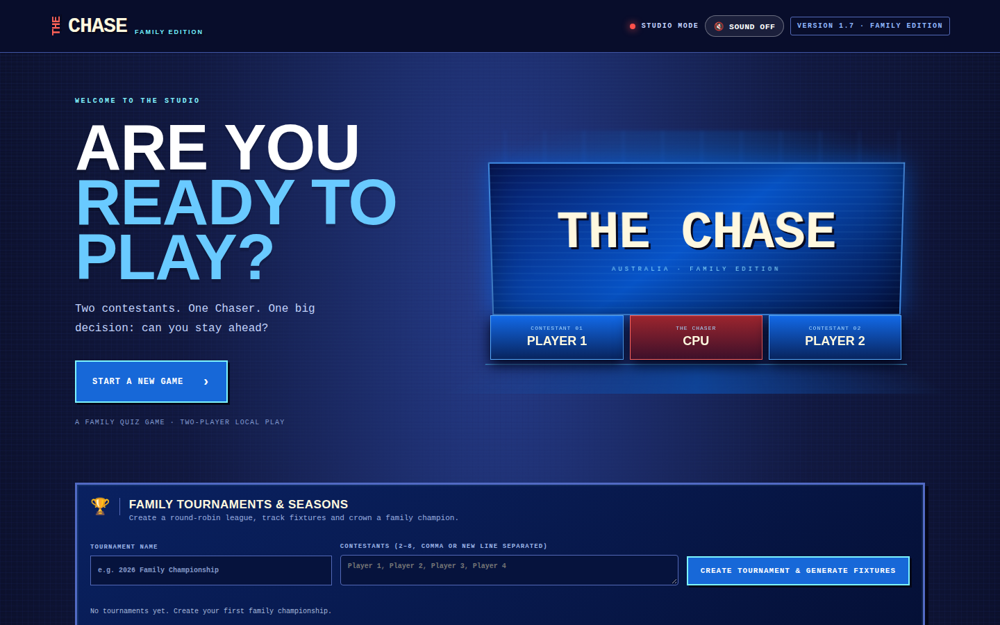

# The Chase Australia: Family Edition

An unofficial, offline-first family quiz game for two contestants, inspired by the broad round structure of televised chase-style quiz shows. Play cooperatively or competitively in a browser.




> **Unofficial fan project.** This project is not affiliated with, endorsed by, or connected to the television programme, broadcaster, production company or presenters. It uses original code and artwork and does not include official programme assets.

## Features

- Cooperative and competitive two-player matches.
- Junior, Family and Challenge difficulty levels, with 120 built-in questions.
- Cash Builder, Head-to-Head offers and an automatic Chaser.
- Final Chase with team pushback and a timed Chaser round.
- Configurable presenter styles and Chaser personalities.
- Custom question editor with JSON import and export.
- Shuffled match-wide question deck with no repeats until the selected pool is exhausted.
- In Head-to-Head, the contestant and Chaser answer the same question each turn; both outcomes resolve together.
- Original pixel-art characters, animated chase board and optional synthesised audio.
- Local match saves, contestant profiles, career statistics, achievements and family records.
- Family tournaments with round-robin fixtures, league tables and playoffs.
- Keyboard focus indicators, responsive layout and reduced-motion support.
- No server, build step, API key, external fonts or runtime network connection.

The Chaser is probability-based. It simulates answer accuracy and does not understand question content.

## Play

1. Download and extract the latest release, or clone this repository.
2. Open `index.html` in a modern browser.
3. Select **Start a New Game** and configure the match.

The game is a static HTML, CSS and JavaScript application. Node.js is not required to play.

### Desktop shortcuts

Optional launchers are included:
- Windows: run `create-shortcut-windows.ps1` from the extracted folder, or open `launch-game-windows.bat`.
- Linux: run `./create-shortcut-linux.sh`, or open `launch-game-linux.sh`.

Keep the game folder in place after creating a shortcut. See `SHORTCUTS-QUICK-START.txt` for details.

## Tournaments

Create a tournament for 2–8 contestants from the home screen. The game generates a round-robin fixture list, awards three points for a win and displays a league table. After the league is complete, the leading contestants enter the playoffs. Two- or three-contestant tournaments go directly to a final; fields of four or more use semi-finals followed by a championship final.

**Tournament results are entered manually.** They are not yet linked to completed live Chase matches. Tournament data is stored separately from contestant career records.

## Local data and privacy

Match saves, custom questions, sound preferences, contestant records and tournaments are stored in the browser's local storage on the current device. They do not automatically sync between browsers or devices. Clearing browser data may delete this information. Export match and question-bank JSON files when you want portable backups.

## Development and tests

The project has no build step or runtime dependencies. To run the automated checks, install [Node.js](https://nodejs.org/) and run:

```bash
npm test
```

The tests cover the question bank, match engine, question rotation, presentation, local records, tournament logic and release checks. They do not replace browser/device testing, accessibility review or human fact-checking of trivia.

See [CONTRIBUTING.md](CONTRIBUTING.md) before submitting changes. Current manual acceptance checks are in [PLAYTEST-CHECKLIST.md](PLAYTEST-CHECKLIST.md).

## Repository layout

```text
.
├── assets/                 # Original local SVG sprites
├── css/                    # Application styles
├── data/                   # Question bank and schema
├── js/                     # Game, records and tournament logic
├── tests/                  # Node-based automated checks
├── index.html
├── package.json
├── CHANGELOG.md
├── CONTRIBUTING.md
├── LICENSE
└── THIRD-PARTY-NOTICES.md
```

## License and acknowledgements

The original code and artwork in this repository are provided under the MIT License; see [LICENSE](LICENSE). Third-party references and attribution notes are documented in [THIRD-PARTY-NOTICES.md](THIRD-PARTY-NOTICES.md).

Names, programme formats and other marks associated with *The Chase* may belong to their respective rights holders. This independent fan project does not claim ownership of those marks.
